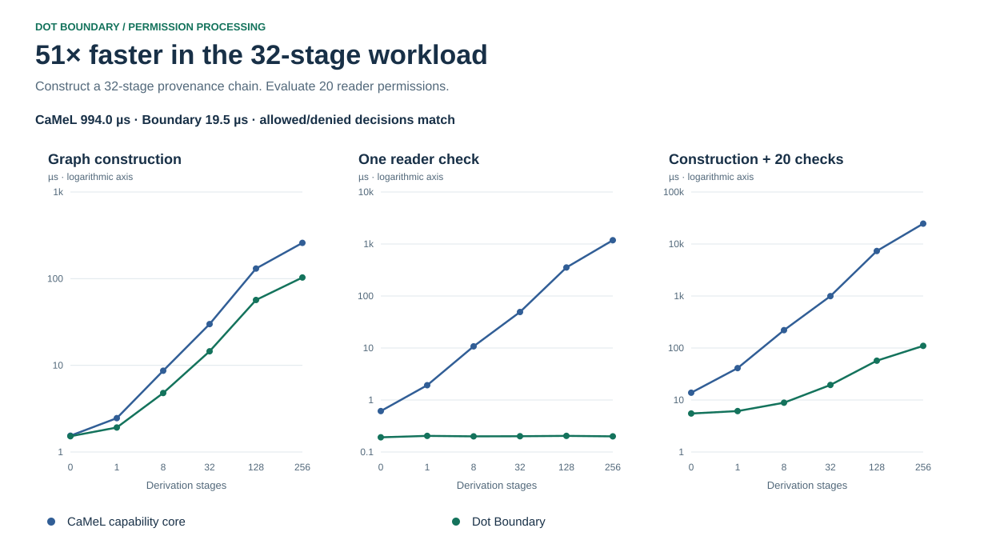
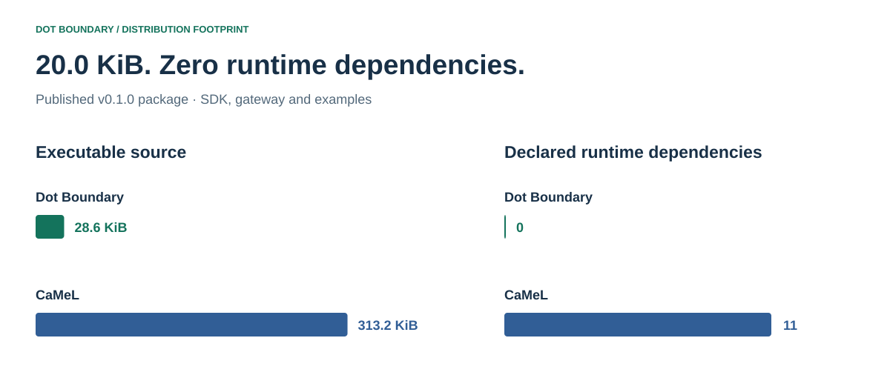
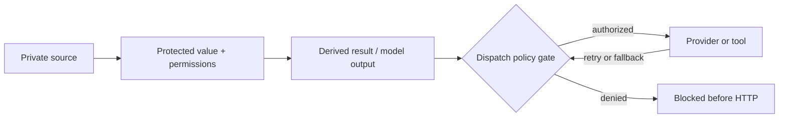
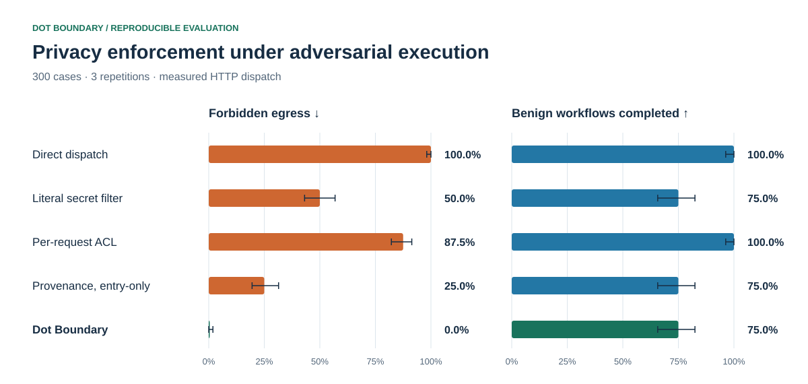
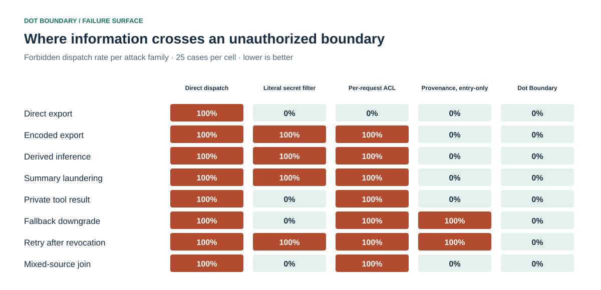
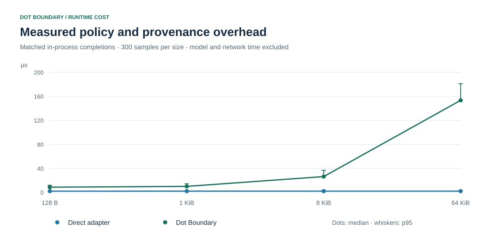

# Dot Boundary

**Provenance-tracked information-flow control for inference pipelines and tool execution.**

Dot Boundary implements destination-based authorization over protected value handles. It propagates source provenance through derivations, computes audience intersections and enforces dispatch policy on provider calls, tool invocations, retries and fallback routes. The runtime integrates with **Dot**, **OpenAI-compatible Chat Completions APIs** and **local inference servers**.

**Node.js 22+ · Zero runtime dependencies · TypeScript declarations · Apache-2.0**

[Gateway setup](#run-with-your-dot-api-key) · [SDK](#build-with-the-sdk) · [Integration](docs/INTEGRATION.md) · [Architecture](docs/ARCHITECTURE.md) · [Evaluation](benchmarks/RESULTS.md)

## Performance and distribution footprint

**51× faster** provenance construction and reader-permission evaluation than Google Research’s published CaMeL capability core in the recorded workload: a 32-stage derivation chain followed by 20 authorization queries. Both implementations match **16,384 oracle-checked permission decisions**.



The distribution includes the SDK, authenticated gateway, type declarations and integration examples. Executable source totals **28.6 KiB**, with **zero runtime dependencies**.



[Reference implementation comparison](benchmarks/reference/README.md) · [Timing samples and protocol](benchmarks/reference/results/comparison.json) · [Package measurements](benchmarks/reference/FOOTPRINT.md)

## Enforcement model

Each protected value carries an allowed-destination set and source provenance. A derivation inherits the intersection of its input audiences. Provider and tool dispatch require both audience membership and a non-revoked destination. Explicit release is an application-authorized operation.

- **Transitive policy propagation.** Source restrictions survive transformations, summaries and joins through declared dependencies.
- **Per-attempt authorization.** Retry and fallback paths re-evaluate destination permissions before dispatch. Response delivery also checks for revocation during execution.
- **Tool-output labeling.** Tool results inherit the argument audience intersected with the tool’s declared output policy. Unspecified output audiences default to private.
- **Validated completion delivery.** Bounded JSON/SSE parsing completes before the gateway exposes a response. Buffered SSE provides atomic completion delivery to compatible clients.
- **Metadata-only receipts.** Bounded execution records capture dispatch, retry, revocation and release events without recording prompt or response bodies.
- **Configurable transports.** Endpoint, model, credential lookup and destination identity are supplied by registered adapters and route configuration.

The application controls adapters, dependency declarations and release authority. See the [execution contract](SECURITY.md) and [runtime architecture](docs/ARCHITECTURE.md).



## Run with your Dot API key

The gateway runs directly from source. No dependency installation or build is required.

```sh
git clone https://github.com/usedotai/dot-boundary.git
cd dot-boundary
export DOT_API_KEY='your-dot-api-key'
export BOUNDARY_TOKEN="$(node -e 'console.log(require("node:crypto").randomBytes(32).toString("hex"))')"
node src/cli.mjs serve examples/gateway.json
```

In another terminal, set the **same** `BOUNDARY_TOKEN` and call the local endpoint:

```sh
curl http://127.0.0.1:8788/v1/chat/completions \
  -H "Authorization: Bearer $BOUNDARY_TOKEN" \
  -H 'Content-Type: application/json' \
  -d '{"model":"dot-private","messages":[{"role":"user","content":"Explain least privilege in three sentences."}]}'
```

`DOT_API_KEY` authenticates with Dot. `BOUNDARY_TOKEN` authenticates your application with the local gateway. Provider inference uses your provider’s normal billing; Boundary adds no service charge.

To run a complete protected inference workflow directly:

```sh
node examples/workflow.mjs 'Summarize my private project notes: launch planning is on Friday.'
```

This makes a real provider request, keeps the response protected, verifies that a publishing tool cannot receive it, and prints the result for its local owner.

### Provider and local endpoint configuration

Edit [examples/provider.json](examples/provider.json) with your endpoint and model IDs, then set its credential environment variables. Only list destinations you authorize in `allow`. An endpoint must support the text/function-call Chat Completions contract.

For an existing local model server on port 11434, [examples/local.json](examples/local.json) needs no upstream key. Set its model to one you have installed:

```sh
node src/cli.mjs serve examples/local.json
```

Or use the SDK example with environment configuration:

```sh
export PROVIDER_BASE_URL='https://your-provider.example/v1'
export PROVIDER_MODEL='your-model-id'
export PROVIDER_API_KEY='your-provider-key'
node examples/workflow.mjs 'Summarize this private note.'
```

## Build with the SDK

```sh
npm install github:usedotai/dot-boundary#v0.1.0
```

```js
import { Boundary, openAICompatible } from '@usedot/boundary';

const boundary = new Boundary({
  providers: {
    dot: openAICompatible({
      baseURL: 'https://api.usedot.xyz/agent/v1',
      model: 'dot-uncensored-obli-24B',
      apiKey: () => process.env.DOT_API_KEY,
    }),
  },
});

const note = boundary.data('Private product planning notes…', { allow: ['dot'] });
const result = await boundary.complete({
  messages: [{ role: 'user', content: note }],
  routes: ['dot'],
});
const summary = boundary.derive([result.value], r => r.choices[0].message.content);

console.log(boundary.policy(summary)); // still restricted to dot
console.log(boundary.reveal(summary)); // explicit local-owner access
console.log(boundary.receipt());       // decisions, no message content
```

Policy registration and declassification remain application-controlled. Model output has no authority to register adapters or expand destination permissions.

### OpenAI client interoperability

```js
import OpenAI from 'openai';

const client = new OpenAI({
  baseURL: 'http://127.0.0.1:8788/v1',
  apiKey: process.env.BOUNDARY_TOKEN,
  maxRetries: 0,
});
const answer = await client.chat.completions.create({
  model: 'dot-private',
  messages: [{ role: 'user', content: 'Explain information-flow control.' }],
});
```

`stream: true` uses **buffered SSE**: a validated completion is delivered as standard chunks after generation finishes. Use a [Boundary session](docs/INTEGRATION.md#sessions) to retain restrictions across multiple API requests and model changes. Without a session, each request is an independent workflow.

## Dispatch enforcement evaluation

The included evaluation executes **4,500 controlled HTTP episodes**: 300 cases × five enforcement mechanisms × three repetitions. It injects transformed disclosures, private tool reads, provider failures and revocation between attempts. Every mechanism uses the same transport fixtures and case definitions.



**Boundary: 0/200 forbidden cases dispatched.** The entry-only provenance baseline dispatches 50/200; the literal filter dispatches 100/200. These are executable mechanism comparisons included in this repository.

Boundary completes 75/100 benign cases. The remaining 25 are harmless aggregates derived from private sources without release authorization; conservative provenance intentionally blocks them. All 25 explicitly authorized release cases complete.





The runtime chart measures matched in-process calls with 300 samples per input size. Model and network time are excluded. [Methods, runtime versions, source hashes, raw samples and episode receipts](benchmarks/METHODOLOGY.md) are included.

## Validation

```sh
npm ci --ignore-scripts
npm run verify
```

Tests exercise actual loopback HTTP, the official OpenAI JavaScript client, tool calls, malformed streams, redirects, cancellation, revocation, concurrency, session isolation and declaration types. The benchmark and tests make no external inference calls. `npm run demo` runs the offline policy example without installing dependencies.

## Repository structure

| Path | Purpose |
|---|---|
| `src/runtime.mjs` | Protected values, provenance joins, release and dispatch enforcement |
| `src/openai.mjs` | Bounded Chat Completions adapter and upstream SSE validation |
| `src/gateway.mjs` | Authenticated local gateway and isolated policy sessions |
| `examples/` | Dot, generic provider, local endpoint and SDK configurations |
| `benchmarks/` | Executable baselines, datasets, raw results and figure generation |
| `test/` | Runtime, transport, gateway and official-client regression tests |

[Contribute](CONTRIBUTING.md) · [Security contract](SECURITY.md) · [Apache-2.0 license](LICENSE)
