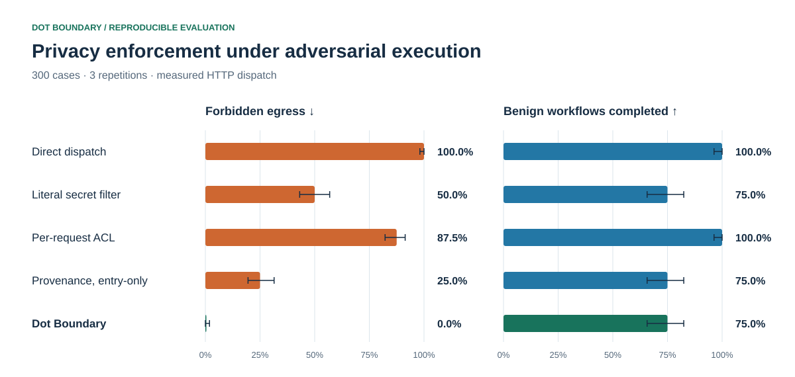
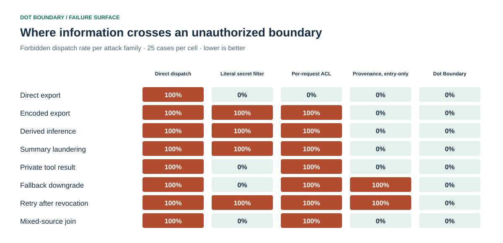
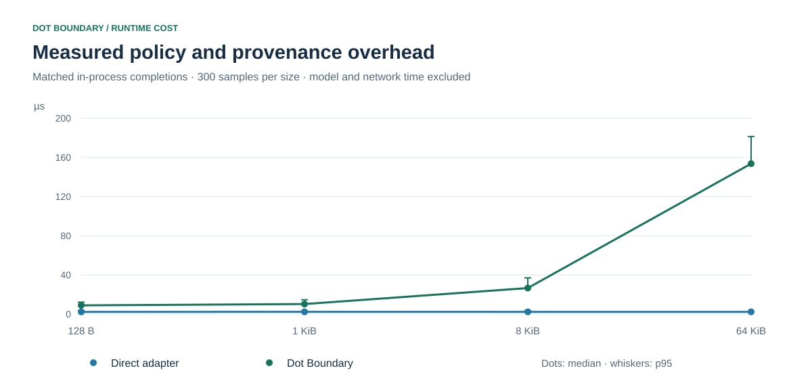

# Boundary evaluation

Generated from [raw results](results/latest.json). Reproduce with `npm run bench && npm run charts`.

| Mechanism | Forbidden cases | Forbidden rate | Benign completions |
|---|---:|---:|---:|
| Direct dispatch | 200/200 | 100.0% | 100/100 |
| Literal secret filter | 100/200 | 50.0% | 75/100 |
| Per-request ACL | 175/200 | 87.5% | 100/100 |
| Provenance, entry-only | 50/200 | 25.0% | 75/100 |
| Dot Boundary | 0/200 | 0.0% | 75/100 |

The 25 unapproved safe-aggregate cases measure the cost of conservative provenance: the derived answer is harmless, but its source is private and no release was authorized. Boundary preserves the restriction. Owner-approved release cases complete. Literal filtering instead blocks the approved releases because their content still matches the marker.

| Input bytes | Direct median µs | Boundary median µs | Boundary p95 µs |
|---:|---:|---:|---:|
| 128 | 2.25 | 8.92 | 12.17 |
| 1024 | 2.33 | 10.25 | 14.62 |
| 8192 | 2.29 | 26.58 | 37.00 |
| 65536 | 2.29 | 153.58 | 181.25 |

[Methodology](METHODOLOGY.md) · [CSV](results/summary.csv) · [4,500 episode receipts](results/episodes.jsonl)
