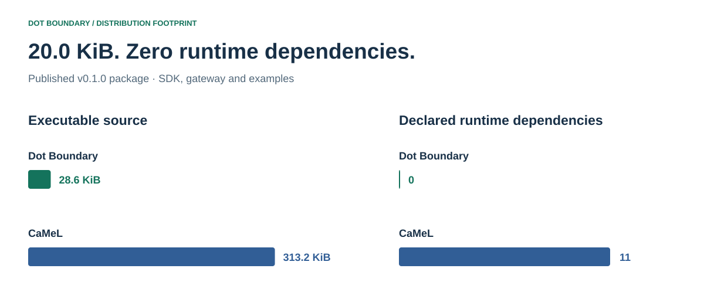

# Distribution and source footprint

Measured from the published v0.1.0 archive and tracked source files. No package installation or model call is required.



| Measurement | Dot Boundary | CaMeL reference |
|---|---:|---:|
| Executable source bytes | 29,335 (28.6 KiB) | 320,692 (313.2 KiB) |
| Executable source files | 7 JavaScript modules | 33 Python modules |
| Direct declared runtime dependencies | 0 | 11 |

The [published Boundary package](https://github.com/usedotai/dot-boundary/releases/tag/v0.1.0) is **20,436 bytes compressed** (20.0 KiB), **62,216 bytes unpacked**, and contains 19 files. SHA-256: `4da379f81ba22a639224e4f8f773784f3849c0dcaa2f04267ef06fa3adcd9fbc`.

## Measurement scope

Source counts include tracked executable files under `src/`: `.mjs` for Boundary and `.py` for CaMeL, including comments and docstrings. They exclude TypeScript declarations, tests, documentation, installed dependencies and the Node/Python runtimes. Dependency counts come from `package.json.dependencies` and `pyproject.toml.project.dependencies`; they are direct declarations, not transitive installations.

The source table covers each complete project: Boundary’s runtime and gateway, and CaMeL’s capability system, Python-subset interpreter and agent integrations. The projects have different feature sets. The archive measurement covers Boundary’s published package; installed memory usage and CaMeL’s compressed distribution are outside this measurement.

[Machine-readable measurements and every file hash](results/footprint.json) · [Performance comparison](README.md)

## Reproduce

With Python 3.11+ and the pinned CaMeL checkout described in [the reference setup](README.md#reproduce):

```sh
curl -fL https://github.com/usedotai/dot-boundary/releases/download/v0.1.0/usedot-boundary-0.1.0.tgz -o /tmp/usedot-boundary-0.1.0.tgz
BOUNDARY_ARCHIVE=/tmp/usedot-boundary-0.1.0.tgz python3 benchmarks/reference/footprint.py
node benchmarks/reference/footprint-chart.mjs
```

Set `CAMEL_SOURCE` to use another local checkout of the exact pinned revision. The archive is inspected without extraction or execution.
