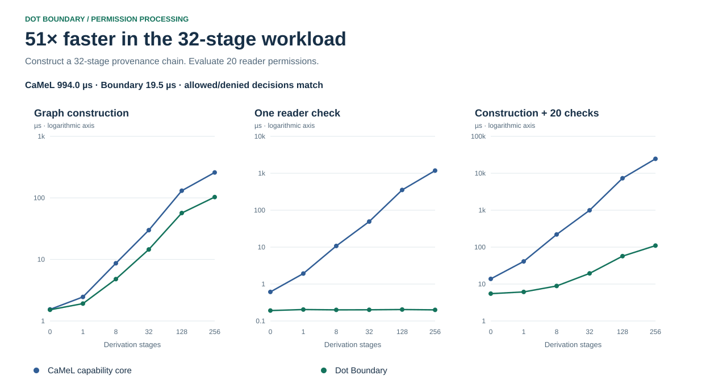
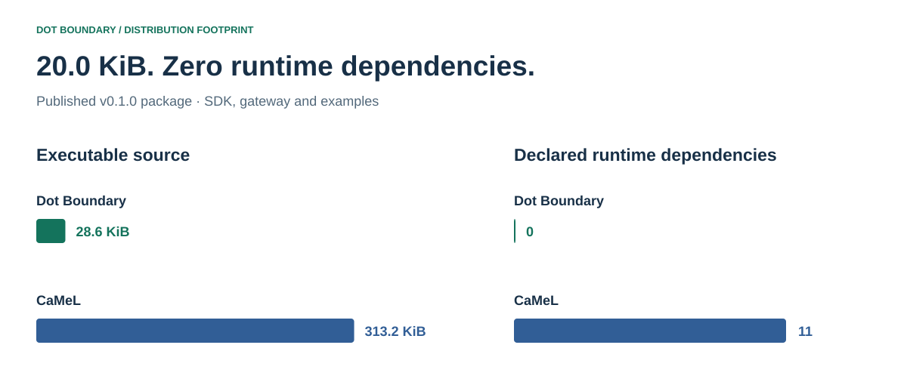

# Provenance and permission-processing benchmark

**Dot Boundary completes a 32-stage provenance chain plus 20 reader-permission checks about 51× faster than Google Research’s published CaMeL capability core in this local microbenchmark.** Both implementations match 16,384 generated permission decisions.



## Results

Each cycle constructs protected data and a chain of additions, then performs 20 alternating allowed/denied reader checks. Both systems compute the same integer and audience. The headline includes graph construction.

| Derivation stages | CaMeL µs | Boundary µs | Paired median speedup | Across five process pairs |
|---:|---:|---:|---:|---:|
| 0 | 13.812 | 5.500 | 2.48× | 2.31–2.69× |
| 1 | 41.041 | 6.125 | 6.72× | 6.61–6.93× |
| 8 | 220.397 | 8.875 | 24.87× | 23.14–25.19× |
| 32 | 994.042 | 19.459 | 51.02× | 47.57–54.90× |
| 128 | 7335.688 | 57.000 | 129.01× | 111.88–136.63× |
| 256 | 24637.062 | 109.937 | 224.10× | 207.81–235.69× |


The speedup is the median of five paired process-median ratios. The range shows the minimum and maximum paired ratios. All construction-only, query-only and combined samples are in [the raw results](results/comparison.json), including the depth-zero construction result of 0.97×.

## Executed implementations

- **CaMeL:** unmodified `CaMeLInt.add`, `get_all_readers` and `can_readers_read_value` from the pinned public source.
- **Boundary:** `Boundary.data`, `Boundary.derive` and the audience returned by `Boundary.policy`, followed by a destination membership check.

Boundary resolves audience intersections during derivation. CaMeL resolves readers by traversing dependency graphs at query time. Repeated queries therefore exercise different amounts of work.

This component benchmark compares the JavaScript and Python implementations with their native representations. CaMeL’s wider interpreter and control-flow isolation, language-model inference and network execution are outside the measured workload. Boundary uses dependencies declared by trusted application code.

## Protocol

- Same host for both implementations; five fresh processes each, alternating execution order.
- Depths: 0, 1, 8, 32, 128 and 256 derivations.
- 500 global warm-up cycles, then 30 warm-ups and 30 timed samples per phase/depth/process.
- Three phases: construction, reader queries and construction plus 20 queries.
- Outputs retained until the clock stops, with validation and teardown outside the timing interval.
- Python 3.10.12, matching the reference repository; Node.js 22.14.0.

The independent correctness corpus contains 4,096 dataflow graphs with public, private, overlapping and disjoint reader sets, shared ancestors and mixed-source joins. Four destinations per graph produce **16,384 decisions**, all matching the oracle in both implementations. Resolved audiences and computed values also match.

## Published trace replay

Seven pinned AgentDojo traces (six injected and one benign) supply 19 recorded tool calls from a calendar-information task. Under the same explicit read-only policy, both systems allow **15 reads** and block **four side effects**. Boundary uses its `invoke` gate with inert callbacks; CaMeL uses its `SecurityPolicyEngine` with the same reader policy.

The replay evaluates recorded tool requests offline. Source URLs and hashes are in [the input manifest](agentdojo-replay-input.json); the original trace metadata is provenance. Full agent task execution and replanning are separate evaluations.

## Sources

| Component | Identity |
|---|---|
| [CaMeL](https://github.com/google-research/camel-prompt-injection/tree/f083b6b396399d3b3c7f2ddaf613a5945eaf32d8) | `f083b6b396399d3b3c7f2ddaf613a5945eaf32d8` |
| Boundary runtime | v0.1.0; per-file SHA-256 hashes in [comparison.json](results/comparison.json) |
| [AgentDojo](https://github.com/ethz-spylab/agentdojo/tree/089ed468cf3ed0322acc66b0211f26d9d90dbf60/runs/claude-3-5-sonnet-20240620/workspace/user_task_0) | `089ed468cf3ed0322acc66b0211f26d9d90dbf60` |

## Reproduce

From the repository root, with Node.js 22+ and Python 3.10:

```sh
mkdir -p .reference
git clone https://github.com/google-research/camel-prompt-injection.git .reference/camel
git -C .reference/camel checkout --detach f083b6b396399d3b3c7f2ddaf613a5945eaf32d8
python3.10 -m pip install --target .reference/deps --no-compile --no-cache-dir \
  -r benchmarks/reference/reference-requirements.txt
python3.10 benchmarks/reference/run.py
node benchmarks/reference/chart.mjs
```

Use `--correctness-only` to run the generated decisions and trace replay without timing. `--aggregate` recomputes summaries from existing timing samples. `CAMEL_SOURCE`, `REFERENCE_DEPS` and `REFERENCE_OUTPUT` select alternative local paths. The runner verifies the upstream revision and source. No API key or paid inference is required.

```sh
node benchmarks/reference/check.mjs
```

This verifies committed source/runner hashes, decisions, timing arithmetic and footprint manifests. Regenerate the corpus with `python3.10 benchmarks/reference/generate_cases.py`.

## Distribution footprint



[Exact package sizes and measurement method](FOOTPRINT.md) · [Third-party licenses](THIRD_PARTY_NOTICES.md)
